# 지원사업 계획서 도우미 — 개발자 전달 문서

> 상인25 `/plan-helper` 개념 프로토타입(PoC)의 설계·구현 설명서입니다. 이 문서와 코드를 그대로 이어받아 정식 개발을 시작할 수 있게 썼습니다.
> 작성 2026-11-26 · 브랜치 `feature/plan-helper` · PC 브라우저 전용(모바일 보류)

## 1. 한눈에 보기

| 항목 | 내용 |
|---|---|
| 목적 | 사장님이 **지원사업 공고문**과 **계획서 양식**을 끌어다 놓으면, 왼쪽에 양식과 같은 모양의 **계획서 뷰**(HTML)가 열리고, 오른쪽 **챗봇 뷰**와 대화하며 칸을 하나씩 채운다 |
| 지원 형식 | HWP · HWPX · PDF(글자 PDF, 스캔 PDF) · DOCX. `.doc`는 docx로 저장해 올리도록 안내 |
| 동작 범위 | 진입 조건(목업 로그인 + 기업정보), 업로드 2칸, 양식 → HTML 재구성, 기업정보 미리 채움, 칸 hover·선택·직접 편집, 챗봇 스트리밍, 제안 적용·되돌리기, 공고문 요약·평가 기준, 캡처(Claude 비전) 재구성, 자동 저장, 인쇄·PDF |
| AI | 서버 측 provider 1개 추상화. `AI_PROVIDER=claude-code`(로컬 개발, 로그인된 Claude CLI) / `anthropic`(배포, API 키) |
| 프로토타입 한계 | 로그인·기업정보·저장이 브라우저 목업(localStorage). 운영 DB 스키마는 마이그레이션 파일만 있음(미적용) |

## 2. 로컬 실행

```bash
npm install
npm run dev                 # http://localhost:3000/plan-helper  (PC, 가로 1280px 이상)
```

1. 화면의 **테스트 계정으로 로그인** (비밀번호 없음, 개발용 목업)
2. **기업정보 입력하러 가기** → `/plan-helper/company`에서 **예시 기업으로 채우기 → 저장** (가상 기업)
3. `/plan-helper`에서 공고문(선택)과 계획서 양식을 끌어다 놓기

AI는 기본으로 이 컴퓨터에 로그인된 Claude Code CLI를 씁니다(`npm run dev`일 때 `AI_PROVIDER` 기본값 = `claude-code`). 터미널에서 `claude` 명령이 되고 로그인돼 있어야 합니다. API 키로 시험하려면 `.env.local`에 `AI_PROVIDER=anthropic`, `ANTHROPIC_API_KEY=...`.

| 명령 | 용도 |
|---|---|
| `npm run typecheck` | 타입 검사 |
| `npm run lint` | ESLint |
| `npm test` | 단위 테스트 (vitest, 45개 — AI 호출은 모두 모의) |
| `npm run build` | 배포 빌드 |
| `node scripts/kordoc-dump.mjs <파일>` | 파서가 읽은 블록 구조 보기 |
| `node scripts/kordoc-render.mjs <파일> <폴더> 1-2 png` | 원본 쪽을 이미지로 (비교용) |
| `node scripts/kordoc-pages.mjs <pdf> <폴더> 1-3` | PDF 쪽 이미지 (캡처 경로 점검) |
| `node scripts/make-variants.mjs <양식.hwp> <폴더> <크롬>` | 한 양식으로 HWPX·글자 PDF·스캔본 PDF 시험 파일 만들기 |

> 실제 공고·양식 파일은 저장소에 넣지 않습니다(공개 저장소). 시험 파일은 `samples-local/`(gitignore)에 두세요.

## 3. 화면 구성

### 3.1 와이어프레임 (PC, 1280px 이상)

```
┌─ 상인25 헤더 ─────────────────────────────── 실시간 공고 · … · [계획서 도우미] ─┐
├─ 툴바 ─────────────────────────────────────────────────────────────────────┤
│ 계획서 제목 · 파일명 · 작성 9/180칸   [공고문 ▢] [계획서 양식 ▢] [인쇄·PDF] [새로 시작] 자동 저장됨 │
├──────────────────── 계획서 뷰 (왼쪽 1/2) ──┬──────────── 챗봇 뷰 (오른쪽 1/2) ─────┤
│ 작성 영역 180개 · 기업정보로 7칸 채움 ■■     │ ▸ [공고문] 디딤돌 제1차 시행계획 (요약·평가 기준) │
│ 모양이 다르면 … 쪽[1-3] [캡처로 다시 만들기]  │ 계획서 도우미 챗봇  (로컬 Claude·개발용)        │
│ ┌──────────── A4 ────────────┐            ├─────────────────────────────────────┤
│ │  ┌──────────────────────┐  │            │  대화기록 (스크롤)                       │
│ │  │ 연구개발계획서 (제목)   │  │            │   [사용자] 이 영역에 초안을 써 줘         │
│ │  └──────────────────────┘  │            │   [도우미] 설명…                         │
│ │  ① 과제 개요                │            │     ┌ 제안 문안 ───────────────┐        │
│ │  ┌────────┬─────────────┐  │            │     │ ○ 최종 목표 …              │        │
│ │  │ 과제명  │ (hover 강조) │  │            │     └─────────────────────────┘        │
│ │  ├────────┼─────────────┤  │            │     [이 영역에 적용] → 적용됨 · [되돌리기]  │
│ │  │개발 목표│▓ 선택됨 ▓▓▓▓│◀─┼─ 클릭 = 선택 ├─────────────────────────────────────┤
│ │  └────────┴─────────────┘  │            │ [선택한 영역] ① 과제 개요 › 개발 목표 ×    │
│ │            - 1 -           │            │ (빠른 요청: 초안 / 평가 기준에 맞게 / …)   │
│ └────────────────────────────┘            │ ┌ 프롬프트 입력창 ────────────┐ [전송]   │
│  (A4 쪽이 이어짐, 칸 폭에 맞춰 배율 축소)      │ └ Enter 전송, Shift+Enter 줄바꿈 ┘        │
└────────────────────────────────────────────┴─────────────────────────────────────┘
```

- 1280px 미만(태블릿·휴대폰)에서는 작업 화면 대신 "PC 브라우저에서 이용해 주세요" 안내만 보입니다 (`plan-helper.css`의 `.ph-narrow`).
- 계획서 뷰는 A4(210×297mm) 쪽 모양 그대로 그리고, 왼쪽 칸이 좁으면 CSS `zoom`으로 통째로 줄입니다(줄바꿈 위치가 원본과 같게 유지).
- 칸 색: 옅은 노랑 = 기업정보로 채움, 옅은 파랑 = AI 제안 적용. 인쇄할 때는 색이 빠집니다.

### 3.2 실제 화면

| 진입 조건 (로그인) | 진입 조건 (기업정보 빠짐) | 기업정보 입력 (목업) |
|---|---|---|
| 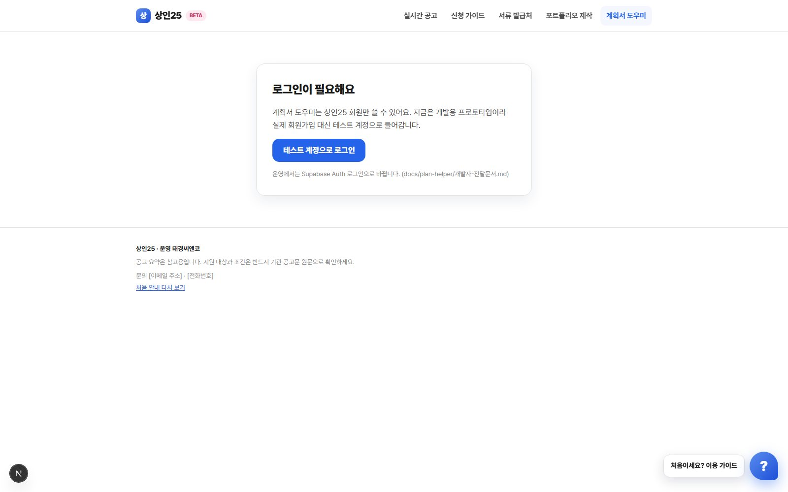 | 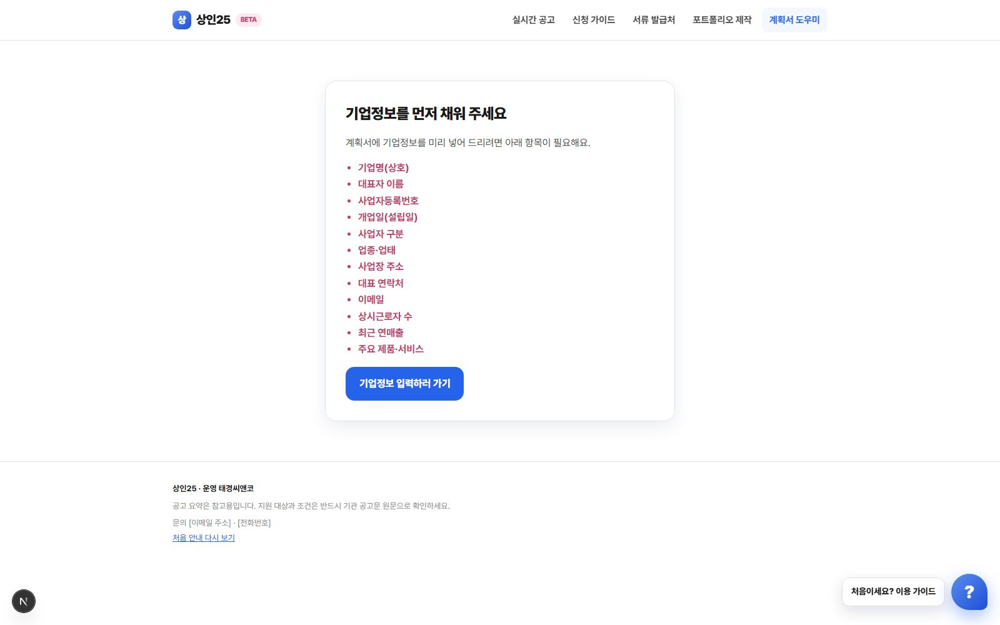 | 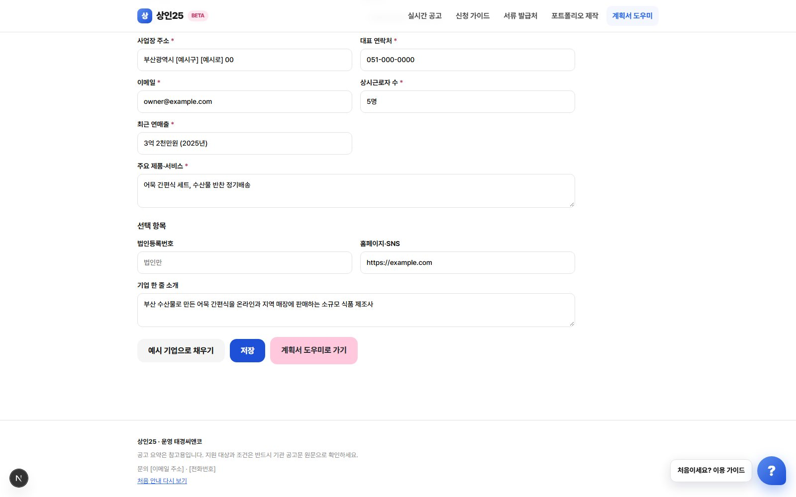 |

| 업로드 | 양식 → 계획서 뷰 | 공고문 요약·평가 기준 |
|---|---|---|
| 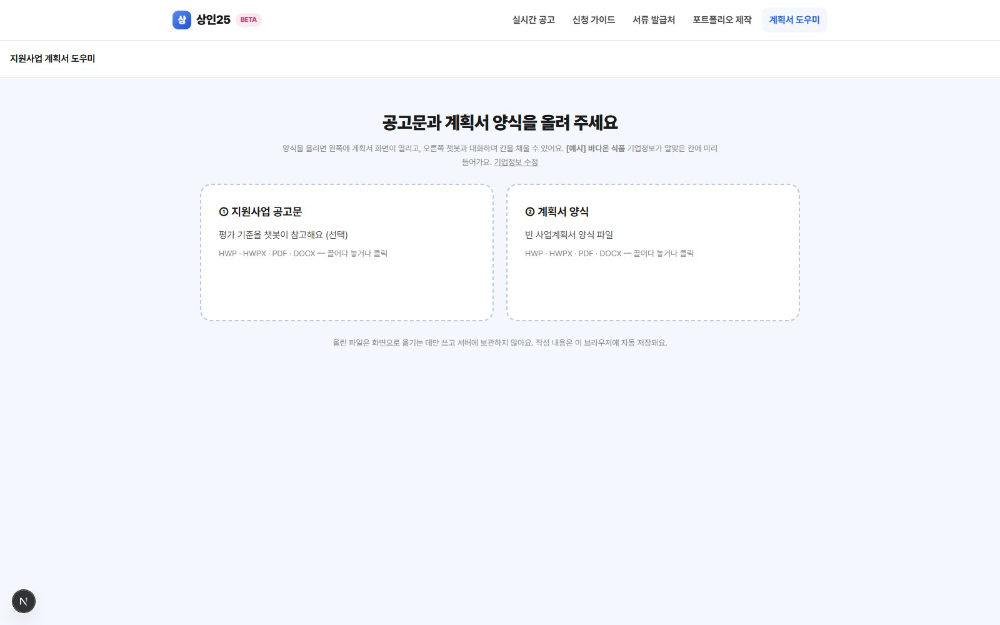 | 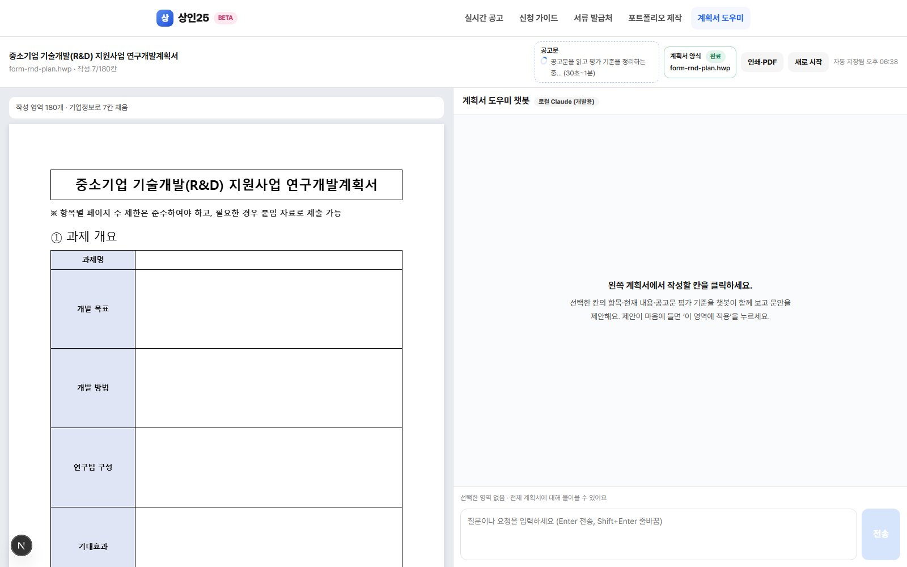 | 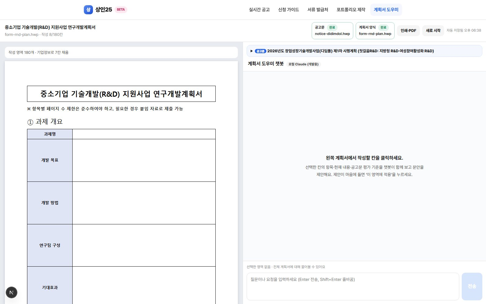 |

| 마우스 가까이 → 강조 | 클릭 → 선택(칩) | 챗봇 제안 | 이 영역에 적용 / 되돌리기 |
|---|---|---|---|
| 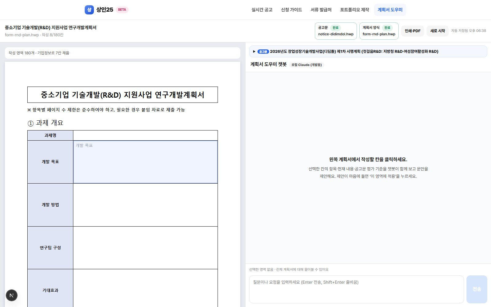 | 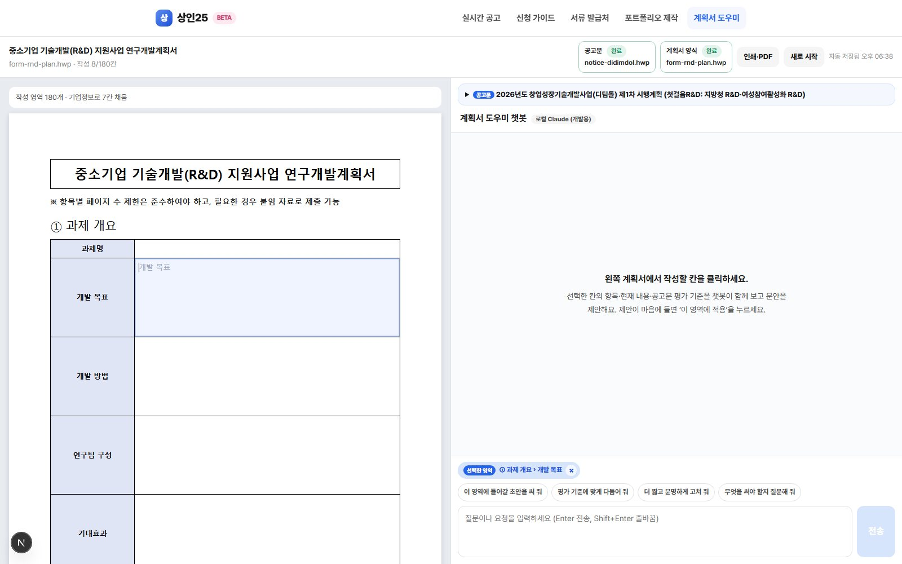 | 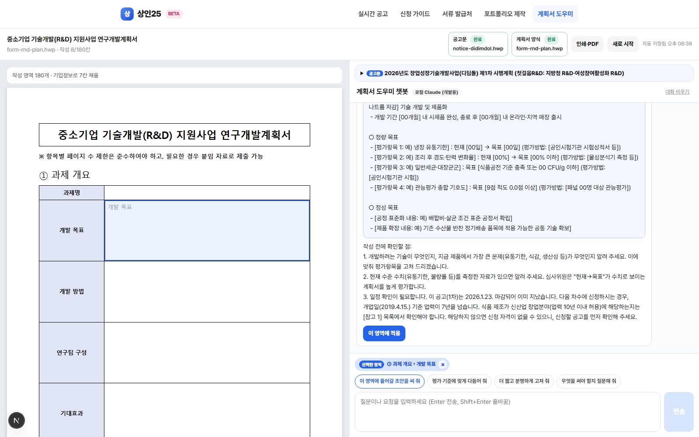 | 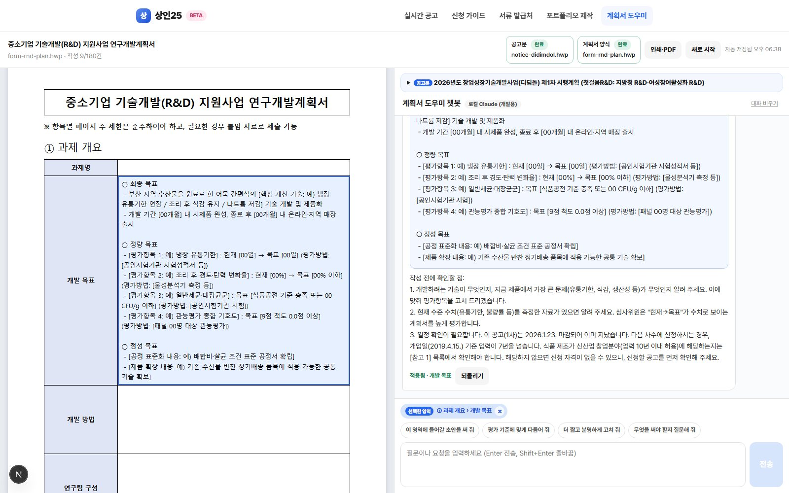 |

## 4. 사용자 흐름

1. **진입 조건** — 로그인 + 기업정보 필수 12개 항목(§6.4). 빠진 항목이 있으면 목록을 보여 주고 기업정보 화면으로 보냄.
2. **업로드** — 드래그 드롭 칸 2개. 브라우저에서 형식·크기를 먼저 검사(`files.ts` `checkFile`), 서버가 한 번 더 검사.
   - 공고문 → `/api/plan-helper/notice` → 글자 추출 → AI 요약(사업명, 요약, 핵심 사항, 평가 기준). 30~60초.
   - 계획서 양식 → `/api/plan-helper/parse` → 중간 표현(PlanDocument). 1~3초.
3. **미리 채움** — 브라우저에서 규칙 매칭(`prefillByRules`) 즉시 적용 → 남은 짧은 칸만 `/api/plan-helper/prefill`(AI)로 라벨 짝짓기 → 브라우저가 값을 채움. **기업정보 값은 서버·AI로 보내지 않고 항목 이름만 보냄.**
4. **작성** — 칸에 마우스를 대면 강조, 클릭하면 선택(챗봇 입력창 위 칩) + 바로 편집. 챗봇은 그 칸의 라벨·현재 내용·양식 안내·공고 평가 기준을 맥락으로 받음. 응답의 `<제안>` 문안은 **이 영역에 적용** 버튼으로 넣고 **되돌리기**로 이전 값 복원.
5. **저장·출력** — 0.6초마다 모아 자동 저장(localStorage). 새로고침해도 이어서 작업. **인쇄·PDF**는 A4 쪽만 인쇄(브라우저 "PDF로 저장").
6. **캡처로 다시 만들기** — 양식이 스캔본이거나 모양이 많이 다르면, 쪽 범위를 골라 페이지 이미지 → Claude 비전으로 다시 그림(쪽당 10~30초, 최대 6쪽).

## 5. 코드 구조

```
src/app/plan-helper/page.tsx              페이지 (PC 전용 안내 + 앱)
src/app/plan-helper/company/page.tsx      기업정보 입력 (목업)
src/app/plan-helper/plan-helper.css       화면 스타일 (A4 쪽, 표, hover/선택, 챗봇, 인쇄)
src/components/plan-helper/
  PlanHelperApp.tsx   전체 상태·흐름 (진입 조건, 업로드, 미리 채움, 챗봇 호출, 적용/되돌리기, 자동 저장, 캡처)
  PlanView.tsx        계획서 뷰: PlanDocument → A4 HTML, 편집 칸(FieldEditor), 배율 맞춤
  ChatView.tsx        챗봇 뷰: 대화기록, 선택 칩, 빠른 요청, 입력창+전송, 제안 상자·적용 버튼
  UploadZone.tsx      드래그 드롭 칸 (큰 칸 / 툴바용 작은 칸)
  CompanyForm.tsx     기업정보 폼 (예시 기업 채우기)
src/lib/plan-helper/
  types.ts            공통 데이터 구조 (PlanDocument, FieldValue, NoticeBrief, CompanyProfile, ChatMessage, Workspace)
  build-document.ts   kordoc 블록 → PlanDocument (표 병합 정리, 제목/안내/글상자/표 구분, 필드 인식), 캡처 결과 변환
  profile.ts          기업정보 필수 항목, 라벨 ↔ 기업정보 규칙 매칭, 미리 채움
  files.ts            업로드 형식·크기 규칙
  storage.ts          브라우저 저장 (목업 세션·기업정보·작업)
  server/parse.ts     서버: kordoc 파싱 (양식 / 공고문)
  server/capture.ts   서버: 쪽 이미지 렌더 → Claude 비전 → PlanDocument
  server/http.ts      서버: 업로드 읽기, 오류 응답, 요청 제한
  ai/types.ts         AiProvider 인터페이스
  ai/claude-code.ts   provider: 로컬 Claude Code CLI (개발 전용)
  ai/anthropic.ts     provider: Anthropic Messages API (배포)
  ai/index.ts         AI_PROVIDER로 provider 선택
  ai/tasks.ts         AI 작업 4개 (챗봇, 공고 요약, 필드 매칭, 구조 추출) + 프롬프트
src/app/api/plan-helper/{parse,notice,prefill,chat,capture,status}/route.ts
supabase/migrations/20261126000000_plan_helper.sql   운영 스키마 초안 (미적용)
```

## 6. 데이터 모델

### 6.1 중간 표현 `PlanDocument` (`types.ts`)

어떤 형식으로 들어와도 먼저 이 JSON으로 바꾸고, 화면·미리 채움·챗봇은 이것만 봅니다.

```
PlanDocument
├─ id, title, fileName, sourceFormat(hwp|hwpx|pdf|docx), parser(kordoc|capture), pageCount, warnings[]
├─ sections[]                         문서 → 섹션(① 과제 개요, 1. 기술개발 목표 …)
│   └─ blocks[]                       섹션 → 블록
│       ├─ heading   { level, text, fontPt }
│       ├─ paragraph { text, note(※ 안내), fontPt, bold }
│       ├─ table     { variant: title|titleBar|guide|box|grid, cols, rows: PlanCell[][] }
│       │     PlanCell { text, colSpan, rowSpan, label, header, fieldId?, align, bold }
│       ├─ image     { src(data URL) | 자리표시 }
│       └─ pageBreak                  원본 쪽이 바뀌는 곳
├─ fields{ id → PlanField }           작성 영역 (고정 id f001, f002 …, 문서 순서)
│     PlanField { id, label, kind: short|long|cell|check, section, guide, template }
└─ fieldOrder[]
```

- `label` 예: `과제명`, `연구원 현황(주관기관) · 성명 (1행)`, `1. 현재 신청인은… — 해당 있음`
- `guide`: 양식 안의 작성 안내(`※ R&D 결과의 검증 방법과 계획은 반드시 포함`, `최대 1페이지`). 공고문 기준 가이드는 챗봇 맥락(NoticeBrief)으로 합쳐집니다.
- `template`: 칸에 원래 적힌 양식 문구(`( ) 부스`, `원`). 값이 없으면 이 문구를 보여 주고 그 위에 고쳐 씀.

### 6.2 채운 값 `FieldValue`

`{ text, source: profile|ai|user, history: [{text, source}] }` — `history`가 되돌리기 스택. 미리 채움·AI 적용 때 이전 값을 쌓고, 사용자가 손댈 때는 처음 한 번만 쌓습니다(타자마다 쌓지 않음).

### 6.3 공고 요약 `NoticeBrief`

`{ fileName, title, summary, keyPoints[], criteria[], excerpt }` — `excerpt`는 원문 앞 2만 자(챗봇이 세부 조건을 찾을 때 씀).

### 6.4 기업정보 필드 (저장소에 회원·기업 모델이 없어 새로 정의)

| 키 | 이름 | 필수 | 계획서 라벨 예 |
|---|---|---|---|
| companyName | 기업명(상호) | ● | 기업명, 업체명, 회사명, 상호, 주관연구개발기관명 |
| ceoName | 대표자 이름 | ● | 대표자, 대표자명 |
| bizNo | 사업자등록번호 | ● | 사업자등록번호 |
| foundedAt | 개업일(설립일) | ● | 설립일자, 개업일, 창업일 |
| bizType | 사업자 구분 | ● | 기업 형태, 사업자 구분 |
| industry | 업종·업태 | ● | 업종, 업태 |
| address | 사업장 주소 | ● | 주소, 소재지 |
| phone | 대표 연락처 | ● | 전화, 연락처 |
| email | 이메일 | ● | E-mail, 이메일 |
| employees | 상시근로자 수 | ● | 상시근로자 수, 종업원 수 |
| revenue | 최근 연매출 | ● | 매출액 |
| mainProducts | 주요 제품·서비스 | ● | 주요 제품, 주력 상품 |
| corpNo | 법인등록번호 |  | 법인등록번호 |
| homepage | 홈페이지·SNS |  | 홈페이지 |
| intro | 기업 한 줄 소개 |  | 기업 소개 |

운영 스키마는 `supabase/migrations/20261126000000_plan_helper.sql`(`companies`, `plan_drafts`, `ai_usage` + RLS 본인 행만). **어떤 DB에도 적용하지 않았습니다.** 정식 개발 때 필요한 항목(업력 계산용 날짜 타입, 매출 연도, 여성기업·벤처 인증 여부 등 공고별 자격 항목)을 더 검토하세요.

## 7. 파싱 파이프라인

```
               ┌──────────── 업로드 (≤20MB, hwp·hwpx·pdf·docx) ───────────┐
               ▼                                                          │
  /api/plan-helper/parse ── kordoc.parse(layoutTables:"keep", keepTrailingEmptyCols) ─┐
               │                                                          │
               │   IRBlock[] (문단·제목·표(병합 포함)·그림, 쪽 번호, 글자 크기)          │
               ▼                                                          │
  build-document.ts  buildPlanDocument()                                  │
    1. 병합 칸 정리 (덮인 자리 제거 → 시작 칸만)                               │
    2. 표 종류: 제목 상자 / 항목 제목 띠 / ※ 안내 상자 / 빈 글상자 / 일반 표      │
    3. 빈칸·양식 문구 칸 → 필드 (라벨 = 같은 행 왼쪽 글 or 열 머리글)            │
    4. 쪽 번호가 바뀌면 쪽 나눔                                              │
               ▼                                                          │
     PlanDocument + needsCapture? ── 글자가 거의 없음(스캔) / PDF 표 부족 ────┘
               │ 예
               ▼
  /api/plan-helper/capture  (사용자가 쪽 범위 선택, 최대 6쪽)
    PDF: kordoc pageImages → PNG      HWP/HWPX: kordoc renderDocument → PNG
    sharp로 긴 변 1568px JPEG → Claude 비전(구조 JSON, 쪽마다 병렬 3개)
    → capturedToIrBlocks() → buildPlanDocument(parser:"capture")
```

### 7.1 형식별 경로와 판단 이유

| 형식 | 경로 | 비고 |
|---|---|---|
| HWP | kordoc (HWP5 바이너리 직접) | 표 병합·쪽 번호·글자 크기까지 읽음. 가장 정확 |
| HWPX | kordoc | HWP와 같은 결과 |
| DOCX | kordoc (`parseDocx`) | 지침의 mammoth 대신 kordoc 사용: 같은 IR(병합 칸·쪽 정보)로 나와 재구성 코드를 하나로 유지할 수 있음. mammoth는 HTML만 내고 병합·쪽 정보가 약함 |
| PDF(글자) | kordoc (내부 pdf.js로 글자·좌표 → 괘선 기반 표 복원) | 표는 잘 복원, 글자 크기·서명란 배치는 일부 달라짐 |
| PDF(스캔) | 캡처: 쪽 이미지 → Claude 비전 | 파서 결과 글자 80자 미만이면 자동 권장 |
| 그 밖 | 캡처 버튼은 항상 노출 | DOCX는 캡처 미지원 → Word에서 PDF로 저장 안내 |

- 왜 kordoc 하나로: HWP·HWPX·PDF·DOCX를 같은 IR로 내주므로 형식별 재구성기를 따로 짤 필요가 없고, 레이아웃 렌더러(`renderDocument`)로 캡처용 쪽 이미지도 같은 라이브러리에서 얻습니다. 서버 번들에서 빼기 위해 `next.config.ts`의 `serverExternalPackages`에 `kordoc`, `pdfjs-dist`, `sharp`를 넣었습니다.
- OCR(`ocr:false`): kordoc 내장 OCR 모델(~18MB 다운로드) 대신 캡처 경로로 통일했습니다. 서버리스에서 모델 다운로드·메모리 부담을 피하고, 표 구조까지 한 번에 얻기 위해서입니다.

### 7.2 필드 인식 규칙 (`build-document.ts`)

| 원본 모양 | 처리 |
|---|---|
| 1×1 표, 글 있음(첫 번째) | 문서 제목 상자 |
| 1×N 표, 첫 칸 `1. 항목명`, 나머지 빈칸 | 항목 제목 띠 → 새 섹션, 다음 글상자 라벨 |
| 1×1 표, `※`로 시작 | 작성 안내 상자 → 다음 필드의 `guide` |
| 1×1 표, 비어 있음 | **긴 글 필드** (라벨 = 가장 가까운 소제목/항목 제목) |
| 라벨|빈칸 행 | 라벨이 목표·방법·계획·효과… 이면 **긴 글**, 아니면 **짧은 글** |
| 머리 행 + 빈 격자 | **표 셀 필드** `표이름 · 머리글 (n행)` |
| `해당 있음/없음`, `예/아니오`, `○/×` 열 | **체크 필드** (클릭하면 ○ 토글) |
| `( ) 부스`, `원`, `Kw` 같은 칸 | 양식 문구를 남긴 **짧은 글/셀 필드** |
| `(1) 소제목 * 최대 1페이지` | 소제목 + `최대 1페이지`를 다음 필드 가이드로 |
| 라벨을 못 찾은 빈칸 | 장식 칸으로 둠 (필드 아님) |

## 8. API 라우트

| 메서드·경로 | 입력 | 출력 | 시간 |
|---|---|---|---|
| `GET /api/plan-helper/status` | — | `{ provider, model, ready, maxUploadMb }` (키 값은 안 줌) | 즉시 |
| `POST /api/plan-helper/parse` | multipart `file` | `{ doc: PlanDocument, needsCapture, reason? }` | 1~3초 |
| `POST /api/plan-helper/notice` | multipart `file` | `{ notice: NoticeBrief }` | 30~60초 (AI) |
| `POST /api/plan-helper/prefill` | JSON `{ fields: PlanField[] }` | `{ matches: [{fieldId, profileKey}] }` | 5~15초 (AI) |
| `POST /api/plan-helper/chat` | JSON `{ messages[], context{notice, docTitle, profile, outline, field} }` | NDJSON 스트림 `{"type":"text"}` … `{"type":"done"}` / `{"type":"error"}` | 첫 글자 2~5초 |
| `POST /api/plan-helper/capture` | multipart `file`, `pages`("1-3") | `{ doc: PlanDocument }` | 쪽당 10~30초 (AI 비전) |

- 모든 라우트 `runtime = "nodejs"`. 오류는 `{ error: "한국어 안내문" }` + 상태 코드(400/413/422/429/502/503).
- 요청 제한은 서버 인스턴스 메모리 기준(분당 4~30회). 운영에서는 로그인 사용자 단위 + 공유 저장소(예: Upstash Redis)로 바꿔야 합니다.

## 9. AI 연결 (요구 8번)

### 9.1 구조

```
화면 ─▶ API 라우트 ─▶ ai/tasks.ts (작업 4개: streamAssistant · summarizeNotice · matchFields · extractStructure)
                         │  같은 인터페이스 AiProvider { streamChat(), completeJson() }
                         ├─▶ ai/claude-code.ts  AI_PROVIDER=claude-code  (로컬 개발 전용)
                         └─▶ ai/anthropic.ts    AI_PROVIDER=anthropic    (배포)
```

- `streamChat` — 대화 스트림. `completeJson` — JSON Schema에 맞는 객체(공고 요약·필드 매칭·구조 추출, 이미지 입력 포함).
- 기본값: `AI_PROVIDER`가 비어 있으면 `next dev`는 `claude-code`, 그 밖(`next start`, Vercel)은 `anthropic`.

### 9.2 `claude-code` (로컬 개발·테스트 전용)

- 이 컴퓨터에 로그인된 Claude Code CLI를 `claude -p --input-format stream-json --output-format stream-json --include-partial-messages`로 부르고, `--system-prompt`로 프롬프트를 통째로 바꾸며 `--tools ""`, `--strict-mcp-config`, `--setting-sources ""`, `--no-session-persistence`로 도구·MCP·설정·세션 저장을 끕니다. 임시 폴더에서 실행해 프로젝트 맥락이 섞이지 않게 합니다. 구조화 출력은 `--json-schema` → 결과 이벤트의 `structured_output`.
- **운영 서비스에 쓰지 않습니다.** 개인 구독 로그인으로 서비스 사용자 요청을 처리하는 것은 이용 약관에 맞지 않고, 서버에는 CLI도 로그인도 없습니다. 코드에서도 `VERCEL` 환경이거나 `NODE_ENV=production`이면 켜지지 않게 막았습니다(`assertLocalOnly`).

### 9.3 `anthropic` (배포)

- 공식 SDK `@anthropic-ai/sdk`(저장소에 이미 있음, 포트폴리오 `/api/polish`와 같은 방식).
- 모델 `PLAN_HELPER_MODEL` 기본 `claude-opus-5-5`. 거절(refusal) 대비로 서버 측 대체 모델 `fallbacks: "default"`(베타 `server-side-fallback-2026-07-01`)를 켰습니다.
- 챗봇: `client.beta.messages.stream()` 스트리밍, 시스템 맥락(공고 요약·계획서 목록)에 `cache_control` → 대화가 이어질수록 입력 비용이 줄어듦. `effort: medium`.
- JSON 작업: `output_config.format = { type: "json_schema", schema }` 구조화 출력, 큰 응답은 스트리밍 + `finalMessage()`로 받아 HTTP 타임아웃을 피함. 비전은 `image` 블록(base64 JPEG).
- 키는 서버 환경변수 `ANTHROPIC_API_KEY`에서만 읽고 응답·로그에 내보내지 않습니다. 오류는 SDK 예외 클래스(RateLimit/Authentication/APIError)로 나눠 한국어 안내로 바꿉니다.

### 9.4 배포 전환 절차 (Vercel 기준)

1. **키 발급** — console.anthropic.com에서 서비스용 워크스페이스를 만들고 API 키 발급. 워크스페이스 월 지출 한도를 먼저 설정.
2. **환경변수 등록** — Vercel 프로젝트 → Settings → Environment Variables (Production·Preview 각각):
   - `AI_PROVIDER=anthropic` (명시 권장)
   - `ANTHROPIC_API_KEY=…` (Sensitive로 저장, `NEXT_PUBLIC_` 접두어 금지)
   - `PLAN_HELPER_MODEL=claude-opus-5-5` (선택)
   - `PLAN_HELPER_MAX_UPLOAD_MB=4` / `NEXT_PUBLIC_PLAN_HELPER_MAX_UPLOAD_MB=4` (아래 5번 해결 전까지)
3. **모델 선택** — 기본 Opus 5.5(입력 $4 / 출력 $20 per 1M 토큰). 비용을 줄이려면 작업별로 나눌 수 있습니다: 챗봇·구조 추출은 Opus 5.5 유지, 공고 요약·필드 매칭은 더 싼 모델로 바꾸고 품질을 비교한 뒤 결정(코드는 `planHelperModel()` 한 곳에서 읽으므로 작업별 모델 변수를 추가하면 됨).
4. **비용·토큰 한도** (추정치 — 실제 `usage`로 다시 잴 것)
   - 공고문 요약: 입력 2~4만 토큰 → 1회 약 $0.1~0.2
   - 챗봇 1턴: 시스템 맥락 1~2만 토큰(캐시되면 1/10 가격) + 출력 0.5~1천 토큰 → 약 $0.02~0.08
   - 캡처: 쪽당 이미지 약 1.6천 토큰 + 출력 3~5천 토큰 → 쪽당 약 $0.1
   - 서비스 한도: 사용자당 일일 대화 수·캡처 쪽수 제한, `ai_usage` 테이블에 `usage` 기록(스키마 초안 포함), 워크스페이스 지출 한도.
5. **업로드 크기** — Vercel 서버리스 함수 요청 본문은 **4.5MB**가 한도입니다. 큰 공고문(예: 8MB 스캔 PDF)을 받으려면 브라우저 → Supabase Storage(또는 Vercel Blob) 서명 URL로 직접 올리고, API에는 파일 경로만 보내 서버가 내려받게 바꿔야 합니다. 그 전까지 한도를 4MB로 낮춰 안내 문구로 막으세요.
6. **타임아웃** — 라우트별 `maxDuration`: chat 300초, capture 300초, notice 120초, parse·prefill 60초. Vercel 요금제의 최대 실행 시간을 확인하고, 부족하면 캡처를 쪽 단위 요청으로 나누고(브라우저가 쪽마다 호출) 진행률을 보여 주세요.
7. **개인정보** — 기업정보 값은 미리 채움 AI 호출에 보내지 않습니다(라벨만). 챗봇에는 사용자가 쓴 계획서 내용·기업정보 요약이 들어가므로 이용약관·개인정보 처리방침에 "AI 처리 위탁(Anthropic)"을 적고 동의를 받으세요. 업로드 원본은 서버에 저장하지 않으며(메모리 처리), 운영에서 Storage를 쓰면 처리 후 삭제(예: 24시간) 정책을 두세요. 주민등록번호 등 고유식별정보 입력 칸은 AI에 보내기 전에 가리는 처리를 검토하세요(kordoc `redactText` 활용 가능).
8. **확인** — 배포 후 `GET /api/plan-helper/status`가 `{"provider":"anthropic","ready":true}`인지 확인.

## 10. 저장

- 프로토타입: 브라우저 `localStorage` (`sangin25:plan-helper:session|profile|workspace:v1`). 작업 묶음 = `{ notice, doc, values, chat }`, 0.6초 디바운스 자동 저장, 새로고침 후 복원. 그림은 장당 400KB·최대 4장까지만 data URL로 넣어 저장 용량(약 5MB)을 지킵니다.
- 운영: Supabase Auth + `plan_drafts`(JSONB) — 사용자별 여러 계획서, 서버 저장. 마이그레이션 초안 참고.

## 11. 형식별 재구성 품질과 한계

같은 공개 양식(2026 디딤돌 「연구개발계획서」 빈 양식, 중소벤처기업부 공고 첨부)을 형식별로 바꿔 올려 비교했습니다. 왼쪽 원본은 kordoc 레이아웃 렌더러(HWP/HWPX), PDF 래스터(PDF)로 그린 이미지입니다.

| 형식 | 결과 | 원본과 다른 점 |
|---|---|---|
| HWP | 작성 영역 180개, 쪽 12장. 표 병합·라벨 칸·쪽 나눔이 거의 같음 | 열 너비가 균등 추정(라벨 24%), 라벨 칸 배경색은 고정색(원본 색 미반영), 바탕체 문단이 고딕으로 보임, 서명란 들여쓰기 없음 |
| HWPX | HWP와 동일 (180개) | 위와 같음 |
| PDF(글자) | 작성 영역 26개(3쪽). 표는 잘 복원 | 일부 문단 글자 크기 작게, 서명란 "신청인/서명" 순서가 바뀜, 쪽 경계에서 제목이 앞 쪽으로 붙기도 함 |
| PDF(스캔) | 캡처 2쪽 20초, 작성 영역 26개. 표·체크 열까지 복원 | 제목 상자 테두리가 사라지고 제목 글자로 바뀜, 글자 크기 추정 |
| DOCX | 실제 행사 참가신청서로 시험: 작성 영역 25개 + 양식 문구 칸 | 큰 배너 그림(>400KB)은 자리표시, 표 머리 색(분홍) 미반영 |

| HWP 1쪽 | HWP 2쪽 |
|---|---|
| 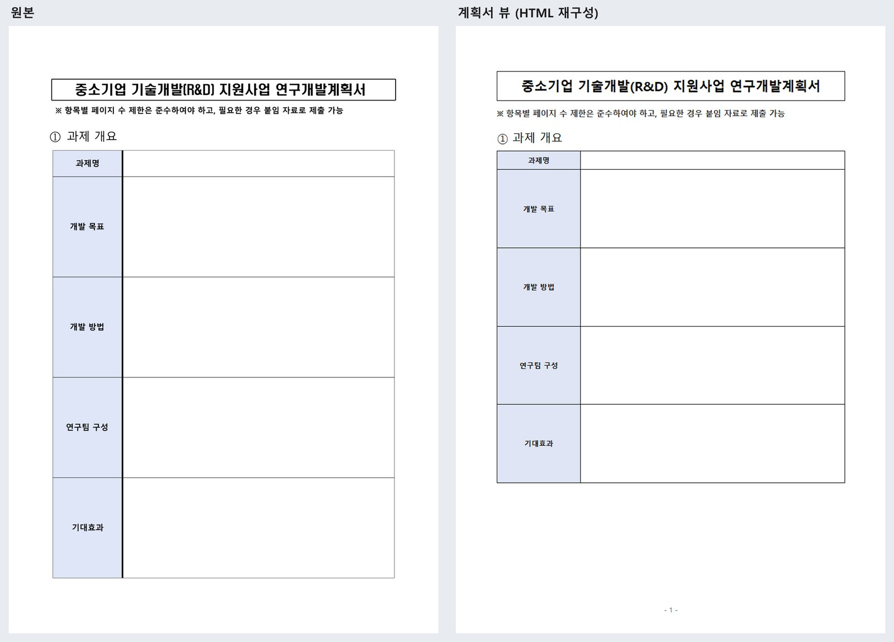 | 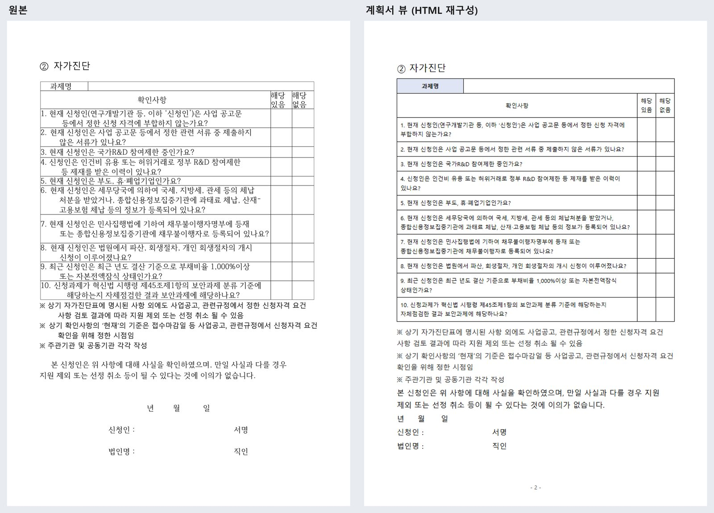 |

| HWPX 2쪽 | PDF(글자) 2쪽 |
|---|---|
| 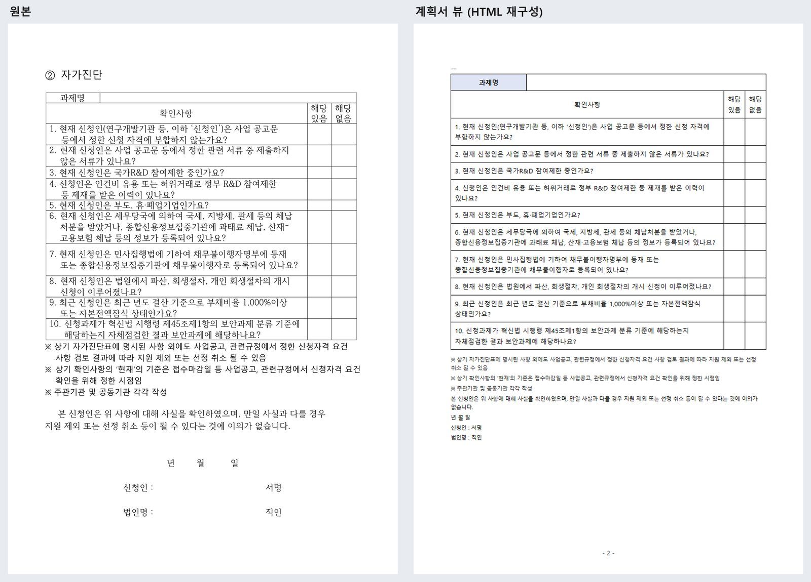 | 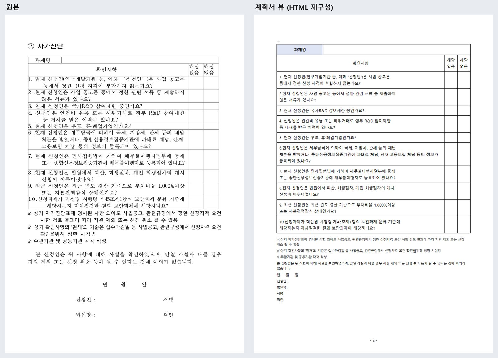 |

| 스캔 PDF → 캡처 1쪽 | 스캔 PDF → 캡처 2쪽 |
|---|---|
| 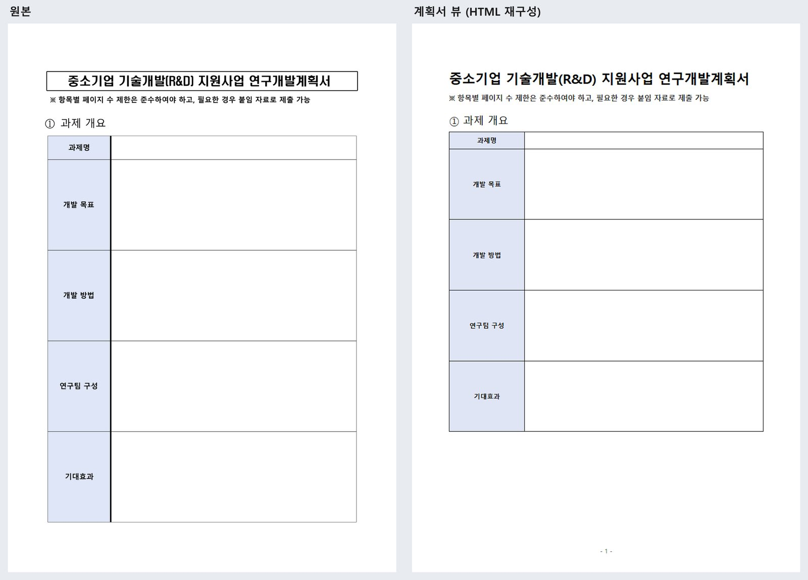 | 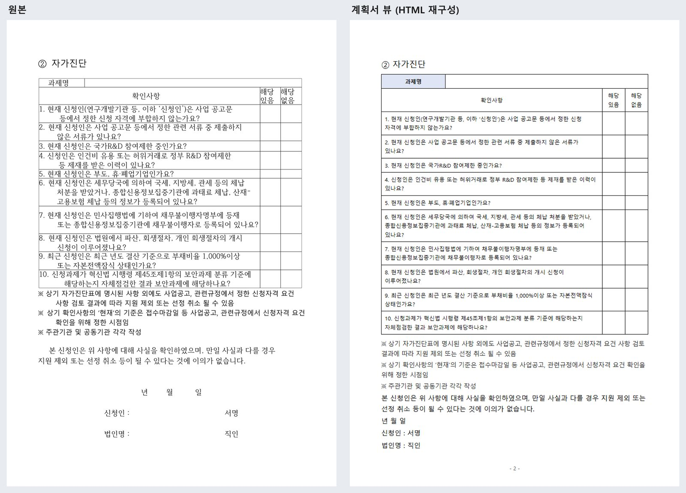 |

공통 한계와 개선 방향:
- **열 너비·행 높이·칸 색**: kordoc IR에는 없음. kordoc `renderDocumentToScene`(HWP/HWPX)의 SVG에서 칸 좌표·배경색을 읽어 `PlanCell`에 `colWidths`·`bg`를 채우면 거의 같아집니다(타입 자리는 `colWidths`로 마련해 둠).
- **글꼴**: 맑은 고딕 기본. HWPX `charPr`의 글꼴 이름을 IR로 받아 함초롬바탕/돋움 웹폰트로 매핑하면 개선.
- **원본 레이아웃 겹쳐 보기 모드**: kordoc SVG 쪽을 배경으로 깔고 필드만 위에 올리는 "원본 그대로 보기"를 두 번째 보기로 추가할 수 있음(편집 시 글이 칸을 넘치는 문제는 따로 처리 필요).
- **필드 인식**: 규칙 기반이라 특이한 양식(가로 2단 라벨, 표 밖 밑줄 빈칸 `____`)은 놓칠 수 있음 → 문단의 밑줄 빈칸·`□` 체크 인식 추가, 또는 AI로 필드 목록 보정.

## 12. 확인한 것

- 로컬(`AI_PROVIDER=claude-code`)에서 실제로: 공고문(HWP) 요약 → 양식(HWP) 재구성 → 칸 hover·선택 → "이 영역에 들어갈 초안을 써 줘" → 스트리밍 응답(공고 기준·업력 조건까지 짚음) → **이 영역에 적용** → **되돌리기** 표시 (스크린샷 05~10).
- 4개 형식(HWP, HWPX, PDF, DOCX) 업로드·재구성, 스캔 PDF 캡처 재구성.
- `anthropic` 경로: API 키가 없어 실제 호출은 하지 않았고, **모의 SDK로 단위 테스트**(스트리밍 텍스트, 모델·fallbacks·캐시 설정, JSON Schema 출력·이미지 블록, 거절 처리, 키 없음 503)를 통과시켰습니다. 배포 전 실제 키로 한 번 돌려 보세요.
- `npm run typecheck`, `npm run lint`(기존 경고 1개 외 없음), `npm test` 45개 통과, `npm run build` 통과.

## 13. 남은 과제 (다음 단계)

1. **회원·인증·DB** — Supabase Auth로 목업 로그인 교체, `companies`·`plan_drafts` 적용, 기업정보 화면을 상인25 회원 메뉴로 이동.
2. **업로드 저장소** — 4.5MB 넘는 파일: Storage 서명 URL 직접 업로드(§9.4-5).
3. **내보내기(범위 밖, 방법만)** — HWP/HWPX: kordoc `fillForm`·`fillHwpx`·`patchHwpxBlocks`로 **원본 HWPX에 채운 값을 그대로 넣어** 내려받기(HWP는 `hwpToHwpx` 후 처리). 필드 id ↔ 원본 표 좌표(`IRTable.sourceId`, 행·열)를 PlanCell에 함께 저장해 두면 1:1로 넣을 수 있음. PDF: 지금의 인쇄 CSS를 서버 Chromium(예: Playwright) 인쇄로 돌리면 파일로 받기 가능. DOCX: `docx` 라이브러리로 표 재생성 또는 원본 XML 치환.
4. **재구성 정확도** — §11의 열 너비·칸 색·글꼴, 밑줄 빈칸·□ 체크 인식, 쪽 경계 정리.
5. **캡처 UX** — 쪽마다 따로 요청 + 진행률, 쪽 미리보기에서 고르기, DOCX 캡처(서버에서 PDF 변환 필요: LibreOffice 컨테이너 등).
6. **챗봇** — 공고문 전문 검색(긴 공고는 요약 + 쪽별 색인), 영역별 글자 수·쪽수 제한 안내, 계획서 전체 점검(평가 기준 대비 빠진 항목) 기능, 대화 길어지면 요약.
7. **비용·남용 방지** — 사용자별 한도, `ai_usage` 기록, 공유 저장소 기반 요청 제한.
8. **접근성·편집기** — contentEditable을 정식 편집기(예: Tiptap)로 바꿔 굵게·글머리표·표 안 줄바꿈 처리, 키보드로 칸 이동(Tab).
9. **모바일** — 보류(요구사항). 열면 PC 안내만.
